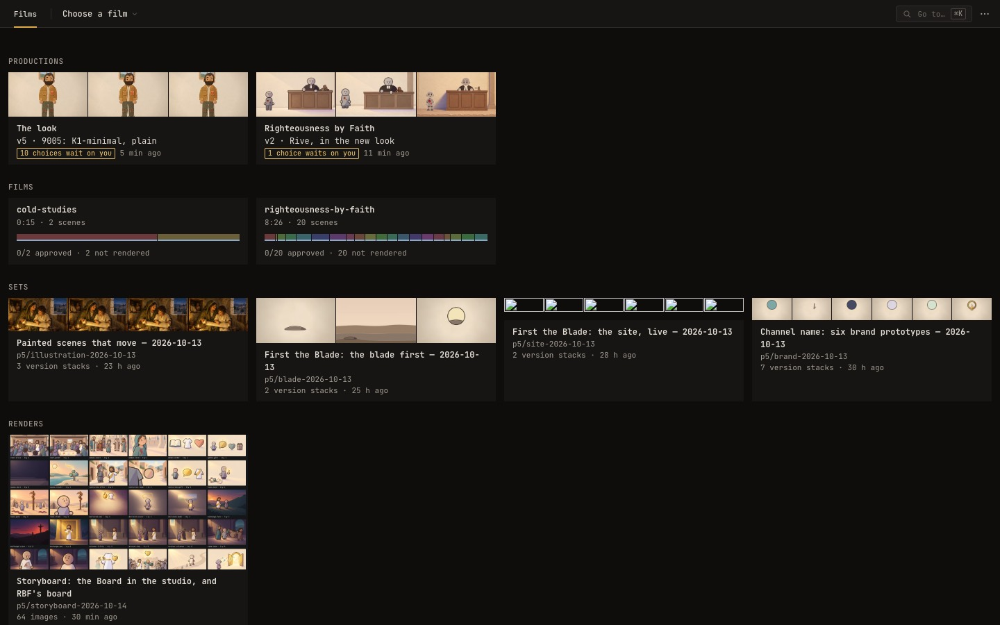
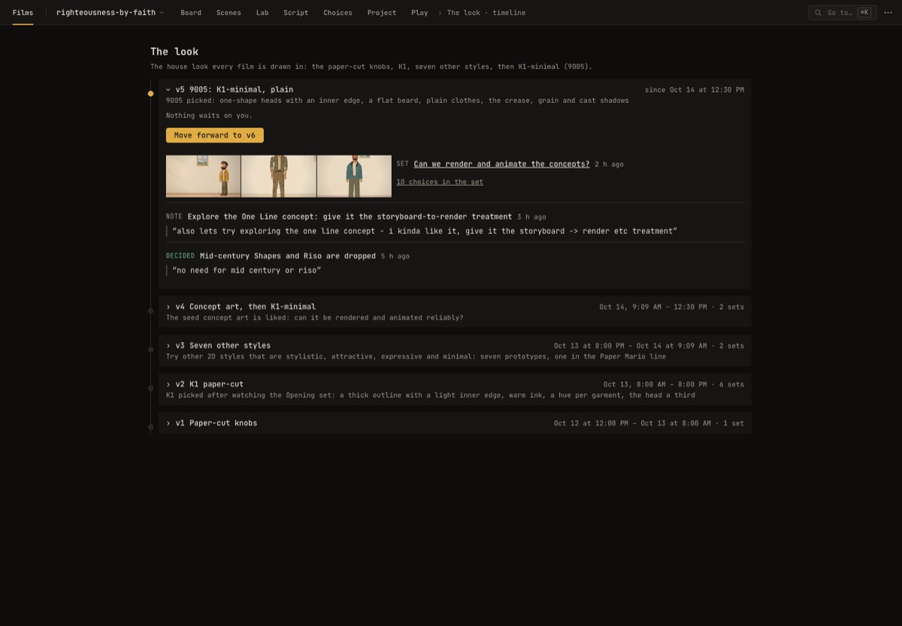
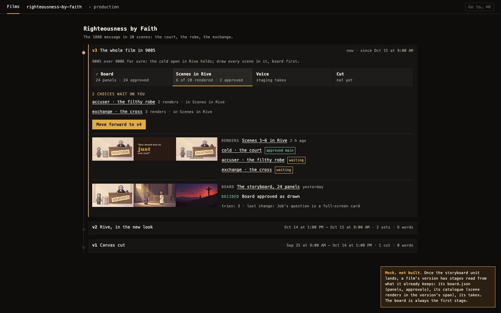
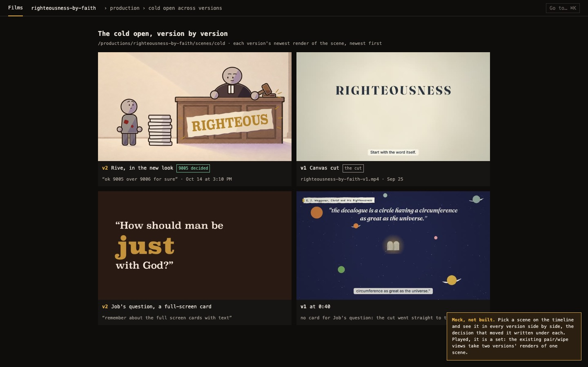
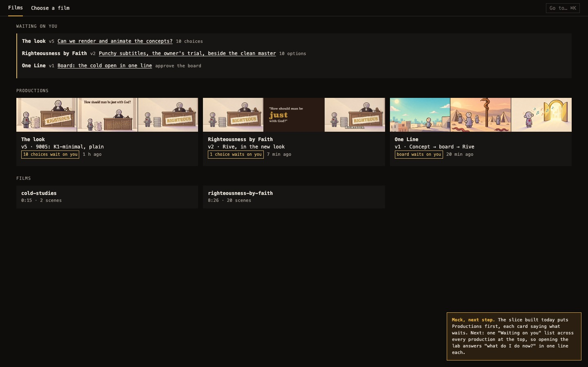

# The lab's timeline — design

The owner, 2026-10-14: "the lab should have a sort version timeline or something, right now its kind of hard
to look through it and see how the projects evolving and moving forward. we should design the product flow
from that so we can easily continue and see whats happening. what renders, choices etc. and once we move
forward we increment versions etc".

Until now the lab's front door was a pile: the films, then every dated folder (`styles-2026-10-13`,
`concepts-2026-10-14`, `rbf-rive-2026-10-14`, …) newest first. Each folder is good on its own; nothing says
which ones belong together, what the owner decided in each, or what comes next. The history lived in chat,
the owner's picks file and the units' journals.

This plan gives the lab one more thing to read: a **production** and its **timeline** of **versions**.

## The words

- **Production**: what the owner follows from start to finish. A film (`righteousness-by-faith`), or a track
  every film depends on (`look`, the house look). Kitsu and ShotGrid call this a production; "project" was
  taken (a film's Project page is its scenes and approvals) and so was "timeline" in the code (a film's clock,
  `core/timeline.ts`), so the code says production and the page says timeline.
- **Version** (v1, v2, …): one round of the production with a purpose ("Rive, in the new look"). A version
  opens when the owner moves forward and stays current until the next one opens. Its number is its place;
  it is never renamed or deleted.
- **Move forward**: closing the current version with a decision ("9005 over 9006 for sure") and opening the
  next with what it is for ("The whole film in 9005").
- **Set**: a review folder (a `review.json` montage or a film's catalogue), as today. The front door's old
  "Versions" heading is now **Sets**, a set page's "Versions" is **Stacks** and each item in a stack an
  **option** (the owner, 2026-10-14: "stacks is fine"), so "version" means one thing on the page: a
  production's v1, v2, …

## The product flow



1. **Open the lab.** The front door lists the **productions** first: each card shows the newest set's
   stills, the current version and its title, and in amber how many questions wait on the owner. A
   production that makes one of the app's films is that film's only card (the owner: "lets try to reduce
   showing twice"): under its head it carries what the film's card said, the film's state and its ways in,
   **Studio** and **Board**. Then the films no production makes (as before), then the **Sets** and
   **Renders** no production holds.
2. **Open a production.** Its timeline (`/productions/<production>`) is one column: the current version open,
   the ones before shut to their head (number, title, dates, how many sets, and on a second line the decision
   that opened it). Opening one shows what happened in it; a link with `?v=<n>` opens that version and scrolls
   to it.
3. **Read a version.** Newest first:
   - each **set** published into it: a still a stack (its pick, else its last variant), its title (a link to
     the set), and up to three of its choices that were picked, decided or wait on a question, then how many
     more the set holds;
   - each **word** of the owner's given outside the lab: _Decided_ (green) or _Note_, said plainly, the owner's
     own words quoted under it, and the set it is about; and each question an agent _Asked_ (amber);
   - each set the version holds that no review root has now, said **Missing** (moved, in the Trash, or on
     another machine), so the history never silently loses a step.
4. **See what waits.** The current version says what waits on the owner: each question an agent asked about a
   set (a lab ask, made by the lab's `ask`: its MCP tool, or `film lab ask`) that no pick in its choice, no later
   decision on it and no close of the ask has answered, whatever version asked it. Each line is the question, linked to its choice (or its set). A set no one asked about
   never waits: a montage of ten stacks is not ten chores.
5. **Move forward.** The current version's one button, "Move forward to v6", opens a short form: _What did we
   decide?_ (started from the owner's newest decision) and _What is v6 for?_, both needed; when questions are
   open it says they stay open after the move. "Open v6" writes the ledger. Every set published from then on lands in v6. If
   someone moved the production forward meanwhile (an agent in a terminal, another tab), the move is refused in
   the receipt ("look is at v6 now, not v5") rather than written over.



## The domain: what is new, what is derived

Only what no file already says is new state. Everything else is read.

**New: the ledger** (`apps/animations/productions/<production>.json`, one per production, committed, written
whole under a lock across processes like the notes; `FILMS_PRODUCTIONS` moves the folder):

- `production`, `title`, optional `film` and `blurb`;
- `versions`: each `{at, title, because?}` in order; the number is the place;
- `said`: the owner's words given outside the lab, each `Decided` or `Noted`, and the questions asked of them,
  `Asked`, all `{at, text, quote?, set?, point?, variant?}`;
- `filed`: `{set, version}` for sets published before sets named their production.

**New and additive in a set's `review.json`**: optional `production`, `version` and `published` (ms since the
epoch). An old `review.json` reads as before; a new one reads on an older lab as before.

**Derived, never stored** (`packages/film/src/core/production.ts`, pure, tested): which version a set is in
(the one it names, else the one open when it was published, else its newest file's time; a filed set where
the ledger files it); the version spans; what waits (`waitingIn`); the timeline (`historyOf`); the front
door's productions (`productionsOf`: every ledger, and every name a set gives that has none yet, so a unit can
publish into a production before anyone opens it); and the sets no production holds (`unfiledOf`).

The choices' state (picked, approved) stays the catalogue's and the set's, read through the index as today.
Nothing is copied into the ledger.

## How agents write to it

The rule (in the film skill's _Serve them_ step): **publish every set onto its production before handing it
over.**

```sh
cd apps/animations
bun cli.ts publish out/rbf-rive-2026-10-14 --production righteousness-by-faith   # lands in the version open now
bun cli.ts publish out/oneline-2026-10-14 --production look --version 5           # made for an older version
bun run production list
bun run lab decide --production righteousness-by-faith --text "9005 over 9006" --quote "ok 9005 over 9006 for sure" \
  --by <you> --set rbf-rive-2026-10-14 --point render:cold --variant 9005
bun run lab note --production look --text "Explore the One Line concept" \
  --quote "also lets try exploring the one line concept" --by <you>
bun run lab ask --production righteousness-by-faith --title "Punchy subtitles or the clean master?" \
  --why "the master's subtitles" --by <you> --set <its ref, as sets lists it> --point render:subtitles \
  --blocks '[{"kind":"choose","id":"pick","label":"Which?","options":[…]}]'   # a page on the running lab: prints its links
bun run lab forward --production look --after 5 --title "One Line" --decision <the decision's at>
```

`film publish` stamps the set's `review.json` (every other field kept) and prints its `/sets/` link. A unit
working in its own worktree needs no ledger to publish: the set names its production and lands by time. An
agent that records the owner's word from chat uses `decide` or `note`, with the owner's verbatim words in
`--quote` and its own name in `--by`; `--at` back-dates a word recorded late. Over the lab's MCP the same is
the `decide` and `note` tools, which require the quote ([lab-mcp.md](lab-mcp.md), "Seams with the timeline"). An agent that hands over a set needing a pick asks on it
(`ask`, which makes the running lab's own ask, a page the owner answers; its `--set` is the set's folder, as
`decide` takes it, and the lab's sets say which one), so the timeline says it waits; the pick in the lab, the
owner's decision recorded on it, or the ask closed answers.

## Seams for other callers (the lab's MCP)

Nothing about the timeline lives in a page handler; the `labmcp` unit (and anything else) calls the same two
seams the lab and the CLI do.

- **Read** — `ProductionStore.list` / `read` (`packages/film/src/tools/production-store.ts`) give the
  ledgers; `productionsOf(ledgers, folders)` (`core/production.ts`, pure) lays the review index's folders
  (`Review`'s index, `GET /api/review/index`) into them and returns each `ProductionHistory`: versions newest
  first, each with its entries (`Published`, `Missing`, `Said`) and, on the current one, `waiting` (the open
  asks, each with its set and choice). `unfiledOf` gives the sets no production holds; `choiceStateOf` a
  choice's state on the line (`Picked`, `Decided`, `Waiting`, `Quiet`). Over HTTP: `GET /api/productions`.
- **Write** — `ProductionStore`'s verbs, each decided on the ledger as read under its cross-process lock:
  `start` (refused `ProductionKept`), `forward` (refused `VersionMoved` when the caller saw an older
  version), `say` (`Decided` or `Noted`, the owner's words, with who filed them; an `Asked` is filed only by a
  lab ask; the lab MCP's `decide` and `note` call it too), `file` (refused
  `VersionUnknown`), and `publish` (stamps a set's `review.json`; `FileInvalid` when it would be no
  manifest). Over HTTP only `forward` is exposed (`POST /api/productions/<production>/versions`); the CLI
  (`film production …`, `film lab decide|note|forward`, `film publish`) is a thin shell over the same verbs.
- **Events** — none pushed yet: a ledger is a file (`FILMS_PRODUCTIONS/<production>.json`), so a watcher
  on that folder sees every move, word and ask, whoever wrote it; the owner's picks and approvals that answer
  an ask are the catalogue's and the sets' as today.

A natural MCP surface: a resource per production (its `ProductionHistory`), and tools `production_forward`,
`production_ask`, `production_decide`, `production_note`, `set_publish` mapping one to one onto the verbs. Built:
`ask` (the lab's asks, filed on the ledger), `decide` and `note`. Moving forward stays the owner's (the
timeline's Move forward, or the CLI on his word), so it has no tool.

## Migration

[`lab-timeline/migrate.sh`](lab-timeline/migrate.sh) writes the first two ledgers through the same
CLI, from the dated sets, the owner's picks and the units' journals:

- **The look** (`look`), five versions: Paper-cut knobs (Oct 12) → K1 paper-cut ("i like k1", Oct 13) → Seven
  other styles (Oct 13 evening) → Concept art, then K1-minimal (Oct 14 09:09) → 9005: K1-minimal, plain ("i
  like 9005"). Twelve dated sets filed into them; the owner's words quoted.
- **Righteousness by Faith**, two versions: Canvas cut (September) → Rive, in the new look (Oct 14 13:00),
  with the concepts and the Rive cold open in v2, two questions asked on it (the cold open's style, answered by
  "9005 over 9006"; punchy subtitles or the clean master, still open). v1's
  cut sits as loose `righteousness-by-faith-v1.mp4` files at the root of `out/` (no folder, no record), so it
  shows as Missing until its catalogue is restored or it gets a folder with a `review.json`.

The two ledgers it wrote are committed in `apps/animations/productions/`, so there is no step to run at
merge: the script is the record of how they were written (a second run stops at its first line, a ledger is
never created twice). Sets for brand, cast and illustration stay unfiled under Sets until the owner names
their productions.

## Where each kind of data lives

The owner, 2026-10-14: "not sure if git is good for binary formats". Git keeps the small text that says what
happened; every picture and render stays out of it, referenced by path and sha.

| Data                                                               | Where                                           | In git                                             |
| ------------------------------------------------------------------ | ----------------------------------------------- | -------------------------------------------------- |
| A production's ledger (versions, the owner's words, asks, filings) | `apps/animations/productions/<production>.json` | committed (text JSON, a few KB)                    |
| A film's board (`board.json`: panels, tries, kept, approvals)      | beside the film, `src/films/<film>/board.json`  | committed (text; each try by file name and sha256) |
| The board's images (tries, refs)                                   | `src/films/<film>/board/`                       | ignored                                            |
| Sets (`review.json` and its stills), renders, a film's catalogue   | `out/<set>/`, `out/<film>/catalogue.json`       | ignored                                            |
| The owner's notes and picks in the lab                             | `lab/` (`FILMS_LAB`)                            | ignored                                            |

A ledger's write is a commit's worth of text; a production's history travels with the branch, so the
Workbox and the laptop read the same timeline. A set it names that is not on this machine reads **Missing**.

## Built: a version in stages

The current version of a production that names its film leads with its first stage, the **board**: one
linked line, `Board · 24 panels, 20 kept · 5 of 8 beats approved ›` (`· 1 stale` when a beat's approval no
longer matches its panels), or `no panels yet`. It reads the storyboard unit's model, not a second one, and
copies nothing into the ledger:

- read: the film's `board.json` through the lab's `board` group (`GET /api/films/<film>/board`), as the
  Board view reads it;
- tally (`boardStageOf`, `core/production.ts`, pure): the picture panels (not text cards), the ones with a
  try kept, and beats approved as they stand (`approvalOf(board, beat)`; a `stale` one counts as not
  approved and is named);
- link: the Board view (`pageHref.board(film)`);
- waits: the line says how many beats are left; approving stays the Board view's verb, and nothing joins
  "what waits on you" unless an agent asks, as with sets, so a board in progress is not a chore list.

## Next (mocked or specified, not built)

**The stages after the board.** The catalogue's (scene renders whose time falls in the version) and the
takes, each a line under the board's.



**A scene across versions.** One scene in every version side by side, the decision that moved it under each.
Built as a published set (one stack, a variant a version), not a new page: the pair and wipe views already
compare two versions' renders of the scene.



**Waiting on you.** One list across every production at the top of the front door, one line each. Built only
once asks are in use: until then each card names its count.



## Open questions

- **Times shown** are formatted where the page renders (the server, then the browser), so a server in another
  timezone shows its own clock until the page hydrates.
- **Renders from a film's catalogue** land on the timeline only as their folder (the film's whole `out/`);
  bucketing each scene's renders by version is the stages after the board.
